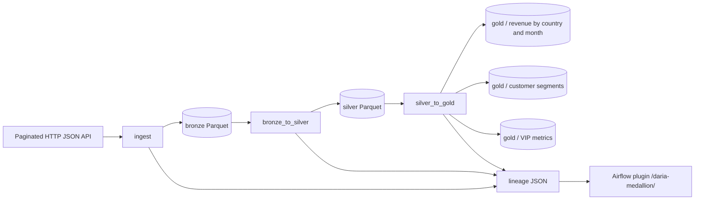

# Scala + Spark on Airflow's Java SDK, inside an Astro CLI project

Repo: [aoelvp94/airflow-scala-spark-demo](https://github.com/aoelvp94/airflow-scala-spark-demo). The question: can Airflow 3.4's JVM language SDK (`org.apache.airflow:airflow-sdk`, JavaCoordinator) run a Scala project that drives Spark, packaged in an Astro CLI project? The answer is yes, with workarounds. See `ISSUES.md` for the changes that should go upstream and `BENCH.md` for the numbers.

## What was tested

| Check | Result |
|---|---|
| Python Dag with `@task.stub(queue="scala")` → Scala `Task` classes running Spark 4.3.0 `local[*]` in the task JVM (`scala_spark_stub_etl`) | ✅ success, XCom passed between JVM tasks |
| Native Dag declared **in Scala** with `DagDef` and parsed by the dag-processor from the bundle jar (`scala_native_spark`) | ✅ parsed and ran (`workload` → `check`) |
| Task logs: Log4j 2 through `airflow-sdk-log4j2` `AirflowAppender`, plus `println` and `System.err` | ✅ all in the task log (stderr lines are logged at level `error`) |
| XCom from Scala types (`scala_sdk_xcom_ergonomics`) | ⚠️ the tasks succeed, but Scala `Map`/`Seq`/`Option`/case class are stored as bean garbage or `{}`. `java.util` collections work (ISSUES.md #2). A standalone reviewer demo of a proposed loud-failure fix is in [`setxcom-demo/`](setxcom-demo/) |
| Same jar via `spark-submit` (BashOperator and SparkSubmitOperator) and the same workload as a PySpark `@task` | ✅ |
| sbt build with SDK 1.0.0 + Spark 4.3.0 or 3.5.9, no overrides | ❌ `Scala module 2.21.2 requires Jackson Databind version >= 2.21.0 and < 2.22.0` (ISSUES.md #1). Fixed with `dependencyOverrides` on `jackson-module-scala` 2.22.2 (or databind back down to 2.21.2) |
| Gradle (upstream `scala_spark_example`) dependency resolution | ✅ Jackson's BOM alignment lifts `jackson-module-scala` to 2.22.2 |
| Fat jar with sbt-assembly | ❌ no `Airflow-Supervisor-Schema-Version` in the manifest → `cannot find a JAR with Airflow-Supervisor-Schema-Version metadata`. `Log4j2Plugins.dat` needs a real merge |
| JavaCoordinator without `main_class` on the Spark thin bundle | ❌ picks `org.apache.commons.compress.archivers.Lister` (6 Spark deps set `Main-Class`). With `main_class` set: ✅ |
| Spark 4.3.0 toy workload without the `--add-opens` set | ✅ ran, but the full `JavaModuleOptions` list is kept in `jvm_args` (`spark-jvm-opts.txt`), as upstream recommends |
| `astro dev start` with `apache/airflow:3.4.0-python3.12` | ⚠️ needs 3 Dockerfile workarounds (ISSUES.md #4). Astro Runtime 3.3-12 is Airflow 3.3, so it is not usable for the Java SDK 1.0.0 |
| JVM in the image | Temurin 17 JRE copied from `eclipse-temurin:17-jre` (multi-stage). The Airflow image has no JRE |
| Classloader isolation | None. JavaCoordinator puts every jar of the bundle on one flat `-classpath`, so Spark's and the SDK's dependencies share it, hence the Jackson clash. One coordinator plus one Dag bundle per classpath is the isolation unit |
| spark-daria 1.2.4 on Spark 4.3.0 `local[*]` (`camelCaseToSnakeCaseColumns`, `DariaValidator`, `composeTransforms`, `singleSpace`, `ColumnExt.isTruthy`) | ✅ compiles and runs; unit tests, a 20M-row local bench, and end-to-end on Airflow 3.4 (`scala_spark_daria`, `scala_native_daria`, and bench modes (d1)–(d3) in BENCH.md) |
| Scala medallion with spark-daria (`scala_spark_medallion`: ingest >> bronze_to_silver >> silver_to_gold) plus an Airflow 3 plugin dashboard | ✅ unit tests, end-to-end on Airflow 3.4, lineage JSON from a Spark 4 `QueryExecutionListener`, dashboard at `/daria-medallion/` |

Versions: Airflow 3.4.0, Task SDK 1.4.0, Java SDK 1.0.0 (Maven Central, 2026-11-13), Scala 2.13.18, sbt 1.13.1, Spark/pyspark 4.3.0, spark-daria 1.2.4, Temurin 17.0.x (Astro image) / Temurin 21.0.13 (local sbt when Docker is down), Astro CLI 1.47.0.

## Layout

```
scala-job/                      sbt project (Scala 2.13, Spark 4.3.0, airflow-sdk 1.0.0)
  build.sbt                     `bundle` = thin bundle in target/bundle, `submitJar` = app jar for spark-submit, `assembly` = fat jar experiment
                                JACKSON_ALIGN=up|down|none, LOG4J_ALIGN, SPARK_VERSION env switches
  src/main/scala/example/scalaspark/
    Workload.scala              shared Spark workload + result file /tmp/bench_results/<mode>/<run_id>.json
    Tasks.scala                 Task classes (bench, stub ETL, XCom ergonomics, no-op, spark-daria / plain)
    NativeDag.scala             Dags declared in Scala with DagDef (`scala_native_spark`, `scala_native_daria`)
    DariaWorkload.scala         spark-daria pipeline and the equivalent plain-Spark path
    DariaBench.scala            local spark-daria vs plain Spark benchmark
    Pipeline.scala              HTTP ingest, spark-daria bronze→silver, gold aggregates
    Lineage.scala               Spark 4 QueryExecutionListener writing dataset/column lineage JSON
    PipelineInspect.scala       print bronze/silver/gold samples and the missing-column error
    Main.scala                  Bundle registration, BundleMain (Server), SubmitApp (spark-submit entry)
  src/main/resources/log4j2.xml AirflowAppender routing
  src/test/scala/...            ScalaTest coverage for the spark-daria path and the ingest/transform pipeline
astro/                          Astro CLI project
  Dockerfile                    apache/airflow:3.4.0-python3.12 + Temurin 17 JRE + Astro workarounds
  requirements.txt              pyspark==4.3.0, apache-airflow-providers-apache-spark
  .env                          [sdk] coordinators / queue_to_coordinator, dag bundles, spark_local connection
  docker-compose.override.yml   host networking on this box (bridge traffic is blocked here), ports 56432/58280
  dags/                         scala_spark_medallion.py, scala_spark_stub_etl.py, scala_spark_daria.py, scala_sdk_xcom_ergonomics.py, bench_dags.py
  plugins/daria_medallion_plugin.py  Airflow 3 FastAPI + external_views dashboard
  include/scala-bundle/         thin bundle (197 jars, includes spark-daria 1.2.4) = Dag bundle "scala-spark"
  include/spark-submit/         scala-spark-workload.jar plus spark-daria_2.13-1.2.4.jar (Spark provided)
bench/af.py, bench/bench.py, bench/make_bench_md.py
BENCH.md, bench.json            benchmark
ISSUES.md                       paste-ready issue drafts (not posted)
setxcom-demo/                   reviewer demo of a proposed Java SDK setXCom loud-failure fix
experiments/                    sbt variants (Spark 3.5.9/4.3.0 × Jackson alignment, fat jar), upstream Gradle resolution check
ref/                            read-only clones of aoelvp94/airflow-java-dag-demo, aoelvp94/airflow-go-dag-demo + upstream files
spark-jvm-opts.txt              Spark 4.3.0 JavaModuleOptions, used as coordinator jvm_args
sbt.sh, build-bundle.sh         sbt in Docker, or a local JDK + sbt if Docker is down; copy bundle into astro/include
```

## spark-daria

The Scala job uses [spark-daria](https://github.com/mrpowers-io/spark-daria) 1.2.4 (`com.github.mrpowers:spark-daria_2.13`), the latest release on Maven Central (2026-10-01). It was published against Spark 3.3.4 (provided), but the helpers used here run on Spark 4.3.0: `camelCaseToSnakeCaseColumns`, `validatePresenceOfColumns` / `validateSchema` / `validateAbsenceOfColumns`, `composeTransforms`, `singleSpace`, and `ColumnExt.isTruthy`.

`SparkDariaWorkload` and an equivalent plain-Spark task (`SparkPlainWorkload`) are registered on the Python stub Dag `scala_spark_daria` and on the native `scala_native_daria` Dag. spark-daria is a compile/runtime dependency, not `provided`, so the thin bundle and the spark-submit folder both ship `spark-daria_2.13-1.2.4.jar`. Spark itself stays out of the submit jar; the Java SDK path still ships Spark inside the bundle. Jackson stays on 2.22.2 and Log4j on 2.26.1; spark-daria did not pull Spark 3.3 or an older `jackson-module-scala`.

A dedicated Airflow `SparkDariaOperator` would be overkill. spark-daria is a DataFrame library, not a runtime, so the right unit is a `Task` that already opens a `SparkSession`.

Local benchmark, same 20M-row workload, one shared `local[*]` session, 1 warm-up + 7 measured rounds, median: spark-daria 353 ms vs plain Spark 354 ms, identical checksum.

Through Airflow (fresh JVM per task, 7 rounds, median queued→end): spark-daria via the Java SDK 7.85 s, the same pipeline in plain Spark via the Java SDK 7.02 s, spark-daria via `spark-submit` 8.59 s. The 0.8 s daria gap on the Java SDK path is all compute and does not show on a hot JVM. See `BENCH.md`.

```bash
./sbt.sh -batch test
./sbt.sh -batch 'runMain example.scalaspark.DariaBench ../bench/daria-local.json'
```

## Medallion pipeline

The demo is a medallion lakehouse in Scala, orchestrated by Airflow 3.4's Java SDK. spark-daria is used as a DataFrame library for validation and transformation, not as something to benchmark. Earlier aggregate benches in `BENCH.md` are left in place and are not extended.



`scala_spark_medallion` and the native `scala_native_medallion` Dag run `ingest >> bronze_to_silver >> silver_to_gold`.

1. **Ingest** starts a process-local paginated HTTP JSON API (JDK `HttpServer` on `127.0.0.1`) and writes raw records as Parquet bronze. The source is deterministic and messy: mixed-case names, string-typed amounts and dates, nulls, exact duplicates, a nested `Address` struct and a `LineItems` array that contains null entries.
2. **Bronze to silver** uses spark-daria 1.2.4:
   - `DariaValidator.validatePresenceOfColumns`, `validateAbsenceOfColumns`, `validateSchema`
   - `DataFrameExt.flattenSchema`, `composeTransforms`, `reorderColumns`, `trans` / `CustomTransform` (with `requiredColumns`), `killDuplicates` (quality metric), `printSchemaInCodeFormat`
   - `transformations.snakeCaseColumns`, `snakifyColumns`, `multiRegexpReplace`, `sortColumns`, `titleCaseColumns` (shown in tests; silver stays snake_case)
   - `functions.singleSpace`, `removeAllWhitespace`, `truncate`, `arrayExNull`, `yeardiff`, `bucketFinder` (on gold)
   - `ColumnExt.isNullOrBlank` for a blank-email flag
   - `EtlDefinition.process` writes the gold tables
3. **Silver to gold** builds business aggregates: revenue by country and month, customer spend segments via `bucketFinder`, and VIP metrics (`orders`, `revenue`, `vip_revenue_share`).

`bucketFinder` in 1.2.4 was written against Spark 3.3 and calls `lit()` on Scala `Option` bucket bounds. Spark 4.3 rejects `lit(Some(x))` / `lit(None)`, so the demo passes `null` and boxed doubles, which is what `lit` + `isNull` expects. The inclusive-bound flags also produce a harmless `true == true` warning from Spark 4.

Bronze, silver, gold, `run.json`, `quality.json` and `lineage/` land in `astro/include/pipeline/<run_id>/`. `build-bundle.sh` keeps that directory world-writable so the Airflow user (uid 50000) can write to the bind mount.

```bash
./sbt.sh -batch test
./sbt.sh -batch 'runMain example.scalaspark.PipelineInspect'
```

## Lineage

Spark Declarative Pipelines (SDP) in Spark 4.3 can describe a dataset graph, but they are a separate pipeline runner (`spark-pipelines` / Python `pyspark.pipelines`), not a column-lineage tracer for existing DataFrame jobs. Rewriting this medallion as SDP would move execution out of the Airflow Java SDK tasks, so SDP is not used here.

The OpenLineage Spark agent (`io.openlineage:openlineage-spark_2.13`, latest 1.55.0) can emit column-level lineage and has Spark 4 support, but the shaded jar is about 42 MiB, it joins the same flat JavaCoordinator classpath as Spark and `airflow-sdk` (Jackson is already pinned), and Spark 4.3.0 shipped the same day as 1.55.0. This demo does not vendor that agent.

What is used instead is a first-party Spark 4 API: `org.apache.spark.sql.util.QueryExecutionListener`, registered on the session in each task. On a successful write it walks the analyzed logical plan (`InsertIntoHadoopFsRelationCommand`, `LogicalRelation` / `HadoopFsRelation`) and records:

- dataset inputs and outputs (Parquet paths)
- column-level links by following `ExprId` values through `Project` / `Alias` (and `GetStructField` for nested columns) back to the source relation's attributes
- a compact `logicalPlan` tree string

Events are written as JSON Lines that follow the shape of an OpenLineage `COMPLETE` run event, including a `columnLineage` array. `summary.json` composes those edges across layers for the dashboard, groups them by target dataset, and drops identity self-mappings. That is honest plan-derived lineage, not a full OpenLineage collector.

## Airflow plugin dashboard

Airflow 3.4 plugins no longer use Flask AppBuilder views. This project registers an Airflow 3 plugin (`astro/plugins/daria_medallion_plugin.py`) with:

- `fastapi_apps` at `/daria-medallion/` — a server-rendered HTML dashboard (no React build, no pandas; it reads `run.json` / `quality.json` / lineage summaries, not Parquet)
- `external_views` with `destination: "nav"`, `url_route: "daria-medallion"`, `nav_top_level: true` — so the page appears in the Airflow UI nav and is embedded in an iframe

The page shows medallion layers (row counts and schemas), daria validation and quality results, a dataset lineage graph with column-level edges, and gold KPIs.

URL: `http://localhost:58280/daria-medallion/` (API / UI port from `docker-compose.override.yml`).

## Coordinator config
## Coordinator config (from `astro/.env`)

```
AIRFLOW__SDK__COORDINATORS={"scala-jdk":{"classpath":"airflow.sdk.coordinators.java.JavaCoordinator","kwargs":{"task_handler_bundle_name":"scala-spark","main_class":"example.scalaspark.BundleMain","jvm_args":["-Xmx1g", "...spark-jvm-opts.txt..."],"task_startup_timeout":60.0}}}
AIRFLOW__SDK__QUEUE_TO_COORDINATOR={"scala":"scala-jdk"}
AIRFLOW__DAG_PROCESSOR__DAG_BUNDLE_CONFIG_LIST=[{"name":"dags-folder",...},{"name":"scala-spark","classpath":"airflow.dag_processing.bundles.local.LocalDagBundle","kwargs":{"path":"/usr/local/airflow/include/scala-bundle"}}]
```

## Commands

```bash
./sbt.sh -batch test                                # includes the spark-daria tests (Docker or local sbt)
./build-bundle.sh                                   # sbt in Docker, or local sbt if Docker is down → astro/include
cd astro && astro dev start --no-browser --wait 3m  # UI/API on http://localhost:58280 (override file)
cd ../bench
uv run --no-project python af.py scala_spark_medallion scala_native_medallion scala_spark_stub_etl scala_native_spark scala_spark_daria scala_native_daria scala_sdk_xcom_ergonomics
BENCH_RUNS=7 BENCH_WARMUP=1 uv run --no-project python bench.py bench.json
uv run --no-project python make_bench_md.py bench.json
cd ../astro && astro dev kill                       # teardown (containers + volumes)
```

The old aoelvp94/airflow-java-dag-demo is not a usable base. It targets 3.4.0b2 with a hypothetical `airflow-dag-processing-java-sdk` artifact, `@DAGDefinition`, and a BashOperator wrapper. The real SDK is `org.apache.airflow:airflow-sdk` 1.0.0 with `Server`/`Bundle`/`Task`/`DagDef`. This project uses the real one.
